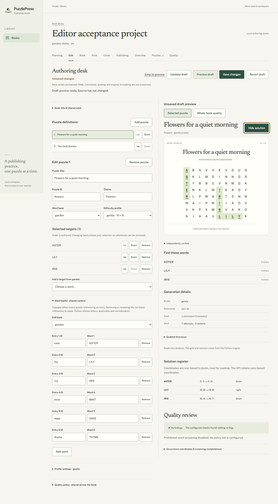
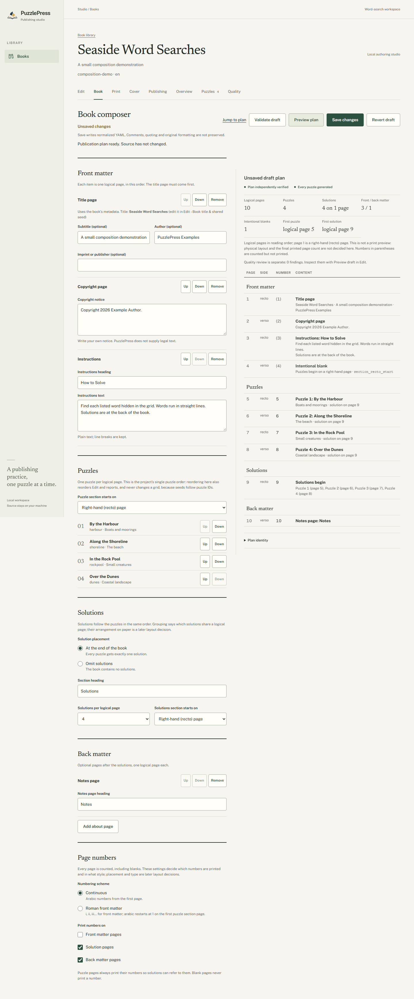
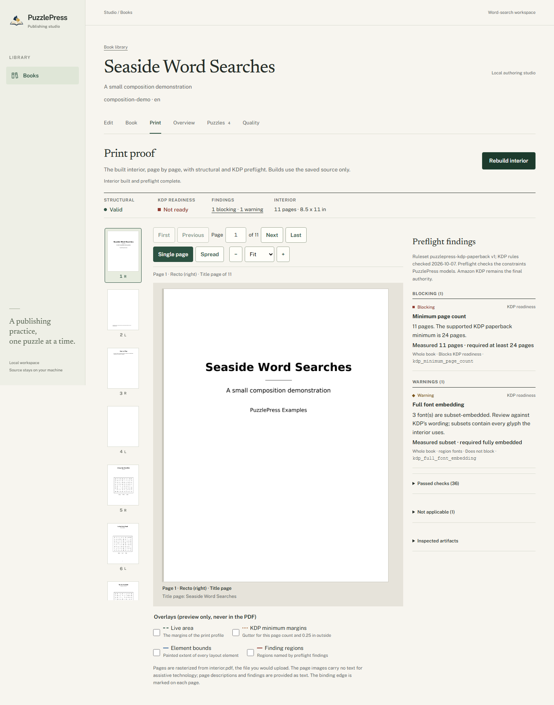
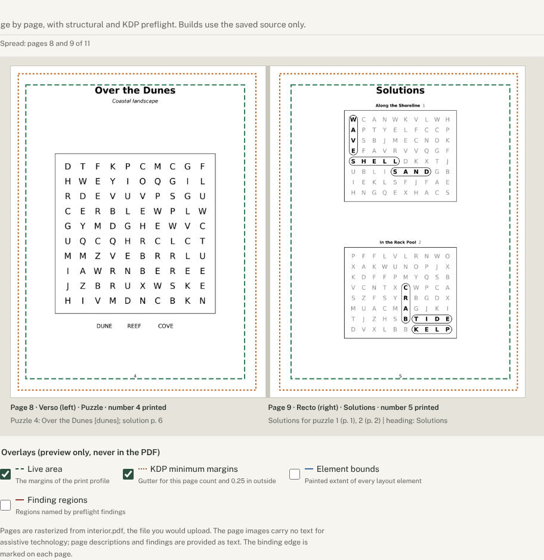
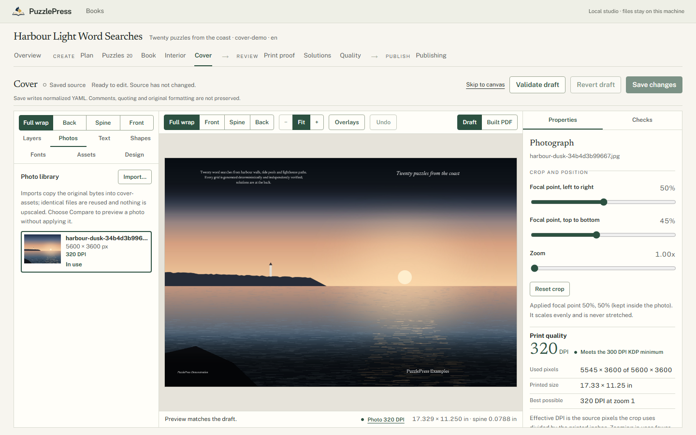
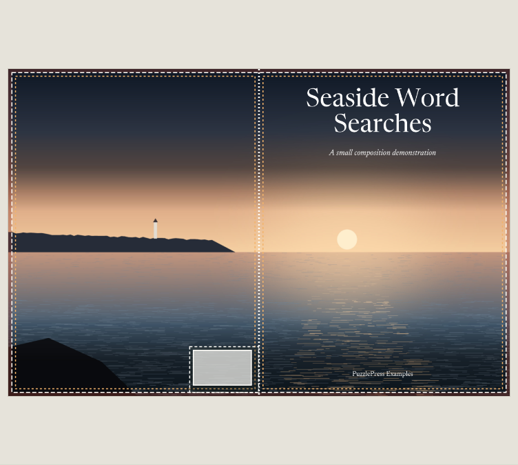
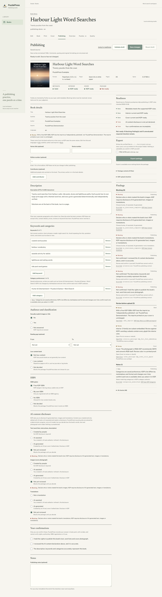
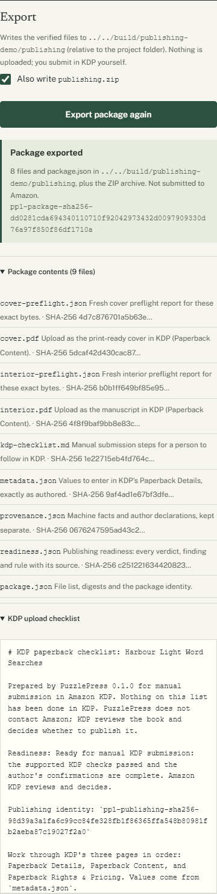

<p align="center">
  
</p>

# PuzzlePress

[](https://github.com/quangshuynh/puzzlepress/actions/workflows/ci.yml)
[](https://www.python.org/)
[](LICENSE)
[](https://docs.astral.sh/ruff/)
[](https://mypy-lang.org/)

PuzzlePress is a deterministic Python engine and local publishing studio for
themed puzzle books. Plan a book from research to an approved blueprint, validate
authored projects, generate verified word searches,
compose them into an ordered book, build a deterministic print interior PDF, preflight
it, proof every real page, build a full-wrap paperback cover around your own
photograph, and assemble a verified package for manual KDP upload, all locally.

**Interval 11 complete:** research and book planning. Plan a book in
`planning.yaml` beside `book.yaml`: research notes labelled by the kind of
evidence they are, comparable books you have read, audience and positioning,
themes and allocations, candidate vocabulary with provenance, planned puzzles and
difficulty. Python checks coverage, vocabulary (with the generator's own rules) and
production feasibility against today's caps, reports readiness gate by gate, and
records your approval of an exact plan. Planning never changes `book.yaml`, never
stales a built book, and never claims market research or commercial success. See
[book planning](docs/book-planning.md).

## Quick start

Requires Python 3.11+. The Studio build also requires Node.js 22+.
From the repository root on Windows:

```powershell
python -m venv .venv
.\.venv\Scripts\python.exe -m pip install -e ".[dev,studio,web-test]"
cd studio
npm.cmd ci
npm.cmd run build
cd ..
.\.venv\Scripts\puzzlepress-studio.exe
```

Open **http://127.0.0.1:8000/books** and choose **Garden Word Searches**.
After setup, start the Studio with the last command alone. One local Python
process serves the UI and API. On Linux/macOS use `.venv/bin/python`,
`.venv/bin/puzzlepress-studio` and `npm`.

For CLI-only use, install with `python -m pip install -e .` and activate the
virtual environment. Runtime dependencies are PyYAML, ReportLab (PDF output),
pypdf (independent PDF inspection) and Pillow (photograph decoding). The `studio` extra adds FastAPI, uvicorn and
pypdfium2 (page previews).

## CLI

```text
puzzlepress --version
puzzlepress validate books/automotive
puzzlepress inspect books/garden-demo
puzzlepress puzzle generate --width 10 --height 8 --seed 2026 --word ENGINE --word PISTON --solution
puzzlepress puzzle batch books/garden-demo --json
puzzlepress puzzle batch books/garden-demo --strict-quality
puzzlepress book plan books/composition-demo
puzzlepress book plan books/composition-demo --json
puzzlepress book build books/composition-demo
puzzlepress book build books/composition-demo --output /tmp/demo-interior --json
puzzlepress book preflight books/composition-demo
puzzlepress book preflight books/composition-demo --json --no-write
puzzlepress book build books/cover-demo
puzzlepress cover inspect books/cover-demo
puzzlepress cover build books/cover-demo
puzzlepress cover preflight books/cover-demo
puzzlepress cover import books/my-book ~/Pictures/harbour.jpg
puzzlepress publish validate books/publishing-demo
puzzlepress publish inspect books/publishing-demo
puzzlepress publish package books/publishing-demo --zip
puzzlepress plan inspect books/automotive
puzzlepress plan report books/automotive --json
puzzlepress plan approve books/my-book --identity pp1-planning-sha256-...
puzzlepress plan handoff books/my-book --json
puzzlepress plan production books/automotive
```

Commands are read-only except `book build`, which writes `interior.pdf` and an
`interior.json` manifest to the project's output directory (here
`build/composition-demo/`) or `--output`, and `book preflight`, which writes only
`preflight.json` beside them (unless `--no-write`). `cover build` writes `cover.pdf`
and `cover.json` beside the interior, `cover preflight` writes `cover-preflight.json`
and `cover import` copies a photograph into the project's `cover-assets/`. `publish package`
writes `publishing/` (and optionally `publishing.zip`) beside them only when the package is ready.
`plan approve` writes only `planning.yaml`; the other `plan` commands are read-only
(`plan report` exits 0 only for a plan ready for approval or approved). `book preflight` exits 0 only
when the interior is structurally valid and KDP ready. `composition-demo` has 11
pages: structurally valid, not KDP ready (the paperback minimum is 24 pages). Exit codes: **0** success, **1** expected configuration
or generation failure, **2** usage error. Batch quality findings are warnings
unless `--strict-quality` is used. `book plan` exits 1 when a puzzle fails to
generate, still printing the plan. `book build` exits 1 with structured
diagnostics (overflow, digest mismatch, invalid profile) and writes nothing. `python -m puzzlepress` is also supported.

## Web Studio

- Plan the book first: research notes, audience, comparable books, themes,
  vocabulary, puzzle allocation and difficulty, with coverage charts, gate-by-gate
  readiness, production feasibility and an explicit, identity-bound approval.
- Discover local projects and inspect metadata, validation and build identity.
- Edit puzzle titles, themes, IDs, ordered targets and reusable word-bank entries.
- Add, remove and reorder puzzles; select and configure shared difficulty profiles.
- Validate unsaved drafts, preview them, then save with stale-source protection.
- Generate and inspect real grids, exact seeds and independent verification.
- Toggle authoritative solutions with highlighted paths and a coordinate register.
- Review quality findings, screening completeness, reuse and similarity reports.
- Compose the book: front matter, puzzle order, solutions, back matter and page numbers.
- Preview the verified publication plan: every logical page, its side and its number.
- Build the interior on white or cream paper, then proof real rendered pages:
  thumbnails, spreads, zoom, margin overlays, and preflight findings linked to pages.
- Design the cover from your own photograph: crop by drag, slider or keyboard, type
  presets, live preview of the real cover PDF, bleed/safe/spine/barcode overlays,
  spine width from the interior, effective DPI, then build and preflight it.
- Prepare KDP metadata with Python findings beside each field, declare AI content,
  confirm rights, see exactly what blocks publishing and export the package.

[`publishing-demo`](books/publishing-demo/book.yaml) is a 35-page book with a
full-wrap cover over a synthetic stand-in photograph and complete KDP metadata;
its interior and cover are KDP ready under the modeled rules, and it awaits a
person's AI disclosure and confirmations before it can be packaged.
[`cover-demo`](books/cover-demo/book.yaml) has the same puzzles with 14 x 14 grids;
its interior and cover are KDP ready under the modeled rules.
[`composition-demo`](books/composition-demo/book.yaml) is a small composed book:
front matter, four puzzles, grouped solutions and a notes page.
[`garden-demo`](books/garden-demo/book.yaml) has two themed puzzles without a
composition. [`automotive`](books/automotive/book.yaml) is the first production book:
60 puzzles in seven themes and three levels, a 95-page interior that preflights
valid and KDP ready under the modeled rules, and its [plan](books/automotive/planning.yaml)
(not approved; no comparable books recorded). Its content is AI-drafted and not yet
human-reviewed, it has no cover photograph, and publishing stays blocked on the
author's decisions ([production notes](docs/automotive-production.md),
[content audit](docs/automotive-content-audit.md)). None is presented as a finished
publishing product.

Open a book and choose **Edit**. Make changes, **Validate draft**, then **Preview
draft** to inspect the grid and quality. **Save changes** validates again and
reloads the persisted source. Drafts survive project tabs; **Revert draft** discards
unsaved work deliberately. Saves canonicalize YAML, including removal of comments
and original formatting. See the [editing workflow](docs/studio.md#authoring-workflow).

Choose **Book** to compose. Reorder puzzles, edit matter and set solution and
numbering policy, then **Preview plan**. The plan is not a print preview: it states
what belongs in the book and in what order, not how pages are laid out. Composition
edits share the same draft, validation and save. See [book composition](docs/book-composition.md).

### A look inside

<p>
  <a href="docs/images/studio/draft-preview.png"></a>
  <a href="docs/images/studio/composer-plan.png"></a>
</p>
<p>
  <a href="docs/images/studio/print.png"></a>
  <a href="docs/images/studio/print-spread.png"></a>
</p>
<p>
  <a href="docs/images/studio/cover-1440.png"></a>
  <a href="docs/images/studio/cover-overlays.png"></a>
</p>
<p>
  <a href="docs/images/studio/publishing.png"></a>
  <a href="docs/images/studio/publishing-export.png"></a>
</p>

Actual application captures from disposable demo projects. See the
[quality review](docs/images/studio/editor-quality.png),
[validation](docs/images/studio/editor-validation.png),
[puzzle ordering](docs/images/studio/composer-order.png),
[narrow composer](docs/images/studio/composer-390.png),
[preflight findings](docs/images/studio/print-findings.png) and
[narrow print proof](docs/images/studio/print-390.png),
[cover readiness](docs/images/studio/cover-readiness.png),
[narrow Cover Studio](docs/images/studio/cover-390.png),
[publishing findings](docs/images/studio/publishing-blocking.png) and
[narrow Publishing](docs/images/studio/publishing-390.png).

## Development

Install the development extras shown above. With the Python environment activated:

```text
python -m pytest --basetemp=.pytest_cache/tmp
python -m ruff check .
python -m ruff format --check .
python -m mypy
python -m pip check
git diff --check
```

From `studio/`:

```text
npm ci
npm run check
npm test
npm run build
npx playwright install chromium
npm run test:browser
```

`npm run check` runs strict TypeScript, ESLint and formatting checks. Browser tests
use real engine output and include accessibility, keyboard, responsive and solution
checks. For hot reload, run `npm run dev` alongside the Python server. Detailed
startup options, API contracts and test commands are in [Studio documentation](docs/studio.md).

CI covers Windows/Linux on Python 3.11, 3.13 and 3.14, interior, cover and publishing package builds on
both OSes, plus a separate frontend and Chromium job. Symlink tests skip when OS permission is unavailable.

## Architecture

```text
                 PuzzlePress Python core
                 /                     \
               CLI                Studio service
                                       |
                                FastAPI / uvicorn
                                       |
                                React / TypeScript
```

planning.yaml -> planning analysis -> readiness -> approved blueprint (handoff only;
no build reads it). Project -> generation -> quality -> composition -> publication plan -> layout -> PDF
-> preflight; built interior facts + photograph + cover section -> cover layout ->
cover.pdf -> cover preflight; metadata + fresh interior and cover preflight ->
readiness -> verified publishing package for manual KDP upload.
The print engine consumes the plan and the generated puzzles, verifies their
digests, lays out pages without repaginating and rejects content that does not fit.

Immutable Python models own validation, deterministic generation, identity,
quality and publication planning. The web adapter exposes existing reports; the browser renders them.
There is no JavaScript generator, solver, planner or second project validator. Build
identities include engine version and output-affecting inputs. Seeds travel over
HTTP as decimal strings. Source and disposable build directories stay disjoint.

Contracts: [book planning](docs/book-planning.md), [project format](docs/project-format.md), [word-search engine](docs/word-search.md),
[batch and quality](docs/batch-quality.md), [book composition](docs/book-composition.md),
[print interior](docs/print-interior.md), [preflight and preview](docs/preflight.md),
[paperback cover](docs/cover.md), [KDP publishing package](docs/publishing.md),
[Studio architecture](docs/studio.md).
Contribution rules: [AGENTS.md](AGENTS.md). Current handoff: [CONTEXT.md](CONTEXT.md).

## Current limitations

ASCII A-Z targets, at most 100 definitions per batch within a 20,000,000-check work
budget, and bounded greedy generation
that can fail on feasible inputs. Quality is descriptive, with explicit scan
limits and no built-in prohibited-word list or automatic repair. Profile names
are authored settings, not calibrated difficulty scores.
Planning reports a plan larger than the 100-puzzle cap as unsupported rather than
raising the cap; its heuristics are review prompts, and no research is verified by
PuzzlePress.

Studio edits only existing `book.yaml` projects within its configured books root.
It has no arbitrary filesystem browser, accounts, cloud services or telemetry.
Drafts are in memory, without autosave or merge; conflicts require review and reload.
Use one Studio process per library. YAML comments and formatting are not preserved.
Frontend assets are built from this checkout. Interiors use one trim (8.5 x 11
in, no bleed, black ink on white or cream paper) and one bundled sans family; books under 24 pages build
with a KDP warning and fail KDP readiness. Preflight models a documented subset of
KDP rules; some official values are ambiguous (see [preflight](docs/preflight.md)).
Covers are RGB without CMYK conversion, use one trim and two layouts, and print
spine text only from 80 pages and only when the spine holds 7 pt type.
Publishing is manual: no KDP login, upload, submission, ISBN purchase, category
taxonomy, keyword research or pricing (see [publishing](docs/publishing.md)).

## License

[MIT](LICENSE).
