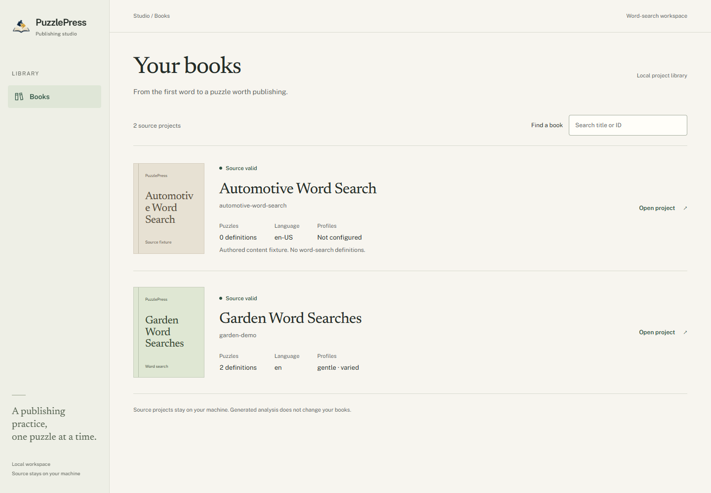
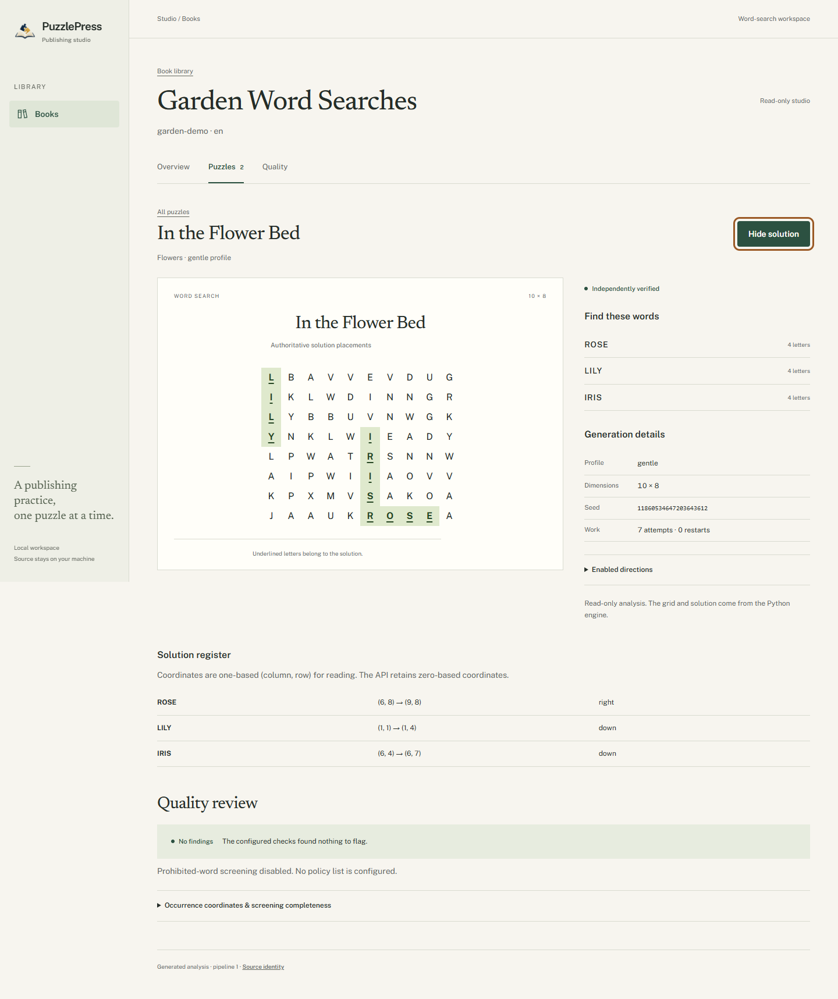

<p align="center">
  
</p>

# PuzzlePress

[](https://github.com/quangshuynh/puzzlepress/actions/workflows/ci.yml)
[](https://www.python.org/)
[](LICENSE)
[](https://docs.astral.sh/ruff/)
[](https://mypy-lang.org/)

PuzzlePress is a deterministic Python engine and local publishing studio for
themed puzzle books. Validate authored projects, generate verified word searches,
and inspect solutions and quality findings through the CLI or browser.

**Interval 4 complete:** a read-only Web Studio uses the same Python core as the
CLI. Browser editing, print/PDF interiors, covers and publishing remain future work.

## Quick start

Requires Python 3.11+. The Studio build also requires Node.js 22+.
From the repository root on Windows:

```powershell
python -m venv .venv
.\.venv\Scripts\python.exe -m pip install -e ".[dev,studio,web-test]"
cd studio
npm.cmd ci
npm.cmd run build
cd ..
.\.venv\Scripts\puzzlepress-studio.exe
```

Open **http://127.0.0.1:8000/books** and choose **Garden Word Searches**.
After setup, start the Studio with the last command alone. One local Python
process serves the UI and API. On Linux/macOS use `.venv/bin/python`,
`.venv/bin/puzzlepress-studio` and `npm`.

For CLI-only use, install with `python -m pip install -e .` and activate the
virtual environment. PyYAML remains the only core runtime dependency.

## CLI

```text
puzzlepress --version
puzzlepress validate books/automotive
puzzlepress inspect books/garden-demo
puzzlepress puzzle generate --width 10 --height 8 --seed 2026 --word ENGINE --word PISTON --solution
puzzlepress puzzle batch books/garden-demo --json
puzzlepress puzzle batch books/garden-demo --strict-quality
```

Commands are read-only. Exit codes: **0** success, **1** expected configuration
or generation failure, **2** usage error. Batch quality findings are warnings
unless `--strict-quality` is used. `python -m puzzlepress` is also supported.

## Web Studio

- Discover local projects and inspect metadata, validation and build identity.
- Review authored word banks, puzzle definitions, profiles and quality settings.
- Generate and inspect real grids, exact seeds and independent verification.
- Toggle authoritative solutions with highlighted paths and a coordinate register.
- Review quality findings, screening completeness, reuse and similarity reports.

[`garden-demo`](books/garden-demo/book.yaml) has two themed puzzles.
[`automotive`](books/automotive/book.yaml) is a small source fixture without
word-search definitions. Neither is presented as a completed publishing product.

### A look inside

<p>
  <a href="docs/images/studio/library.png"></a>
  <a href="docs/images/studio/solution.png"></a>
</p>

Actual application captures. See the [project overview](docs/images/studio/project.png),
[normal puzzle view](docs/images/studio/puzzle.png), and
[mobile inspector](docs/images/studio/mobile.png).

## Development

Install the development extras shown above. With the Python environment activated:

```text
python -m pytest --basetemp=.pytest_cache/tmp
python -m ruff check .
python -m ruff format --check .
python -m mypy
python -m pip check
git diff --check
```

From `studio/`:

```text
npm ci
npm run check
npm test
npm run build
npx playwright install chromium
npm run test:browser
```

`npm run check` runs strict TypeScript, ESLint and formatting checks. Browser tests
use real engine output and include accessibility, keyboard, responsive and solution
checks. For hot reload, run `npm run dev` alongside the Python server. Detailed
startup options, API contracts and test commands are in [Studio documentation](docs/studio.md).

CI covers Windows/Linux on Python 3.11, 3.13 and 3.14, plus a separate frontend and
Chromium job. Symlink tests skip when OS permission is unavailable.

## Architecture

```text
                 PuzzlePress Python core
                 /                     \
               CLI                Studio service
                                       |
                                FastAPI / uvicorn
                                       |
                                React / TypeScript
```

Immutable Python models own validation, deterministic generation, identity and
quality. The web adapter exposes existing reports; the browser renders them.
There is no JavaScript generator, solver or second project validator. Build
identities include engine version and output-affecting inputs. Seeds travel over
HTTP as decimal strings. Source and disposable build directories stay disjoint.

Contracts: [project format](docs/project-format.md), [word-search engine](docs/word-search.md),
[batch and quality](docs/batch-quality.md), [Studio architecture](docs/studio.md).
Contribution rules: [AGENTS.md](AGENTS.md). Current handoff: [CONTEXT.md](CONTEXT.md).

## Current limitations

ASCII A-Z targets, at most 20 definitions per batch, and bounded greedy generation
that can fail on feasible inputs. Quality is descriptive, with explicit scan
limits and no built-in prohibited-word list or automatic repair. Profile names
are authored settings, not calibrated difficulty scores.

Studio is local and read-only. It reads a deliberately scoped books directory;
it has no arbitrary filesystem browser, accounts, persistence, cloud services or
telemetry. Frontend assets are built from this checkout. PDF output, browser
editing, covers, KDP and publishing automation are not implemented.

## License

[MIT](LICENSE).
